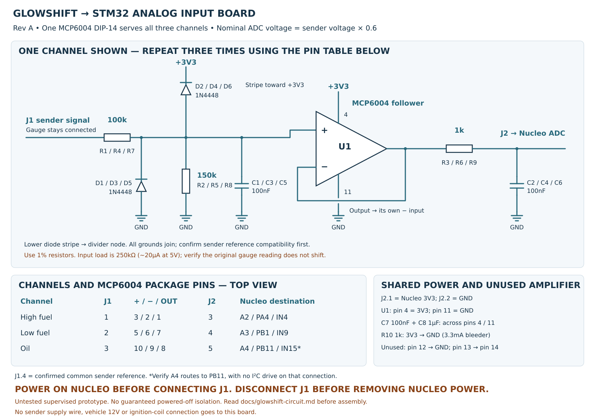

# Three-channel GlowShift input board — rev A

[Sensor measurements and calibration](glowshift-inputs.md) ·
[Schematic](../hardware/glowshift-input/schematic.svg) ·
[Parts list](../hardware/glowshift-input/bom.csv) · [Shopping list](#shopping-list) ·
[Complete connections](../hardware/glowshift-input/connections.csv)

Build **one board with one MCP6004 DIP chip**, serving all three senders. All
parts are through-hole. It scales a nominal 0–5V sender signal to 0–3V, buffers
it and filters noise before the Nucleo ADC. The shopping list below totals
$13.51 including connectors and spares, using the owner's existing board;
shipping, tax, any tariffs and tools are additional.
This is an untested prototype design, not a completed automotive installation.
Pressure firmware/display support is still pending.



## Current scope — October 19, 2026

Only **low fuel pressure and oil pressure** are planned for acquisition now.
High-pressure fuel stays on its existing gauge; its former C2 pair 4/9 is now
reserved for RPM. The original three-channel schematic/BOM below is retained
as a reference. Do not wire its high-pressure input into the RPM pair.

If the original pressure board is already assembled, the high-pressure input
can remain disconnected: its fitted 150k divider resistor holds amplifier A's
input near ground. If omitting that entire channel during a new build, terminate
amplifier A as an unused follower: pin 3 to GND, pin 2 to pin 1, output left
unloaded. Amplifier D stays terminated as documented. A2/PA4 is unallocated;
the RPM timer GPIO has not been assigned.

## Parts to gather

- One **MCP6004-I/P** (or -E/P) and one 14-pin DIP socket.
- Three **100k**, three **150k**, four **1k** resistors; 1%, 0.25W metal film.
- Six **1N4448** axial diodes.
- Seven **100nF** and one **1µF** nonpolar ceramic capacitors, rated at least 25V.
- A soldered prototyping board, a 4-way input plug and a 5-way MCU plug.

The 1k supply bleeder and the IC bypass capacitors are shared by all channels.
Leave the existing sender supply wiring connected to its gauge. This board
has no connection to the gauge/sender supply wire, vehicle 12V or coil negative.

## Build the common power section first

With **all power and signal plugs disconnected**, install the socket with its
notch clearly marked. All pin numbers below are top view, notch at the top;
pin 1 is upper-left, numbers run down the left and back up the right.

1. J2.1 = Nucleo **3V3**, to U1 pin **4**. J2.2 = Nucleo **GND**, to pin **11**.
2. C7 (100nF) directly between pins 4 and 11, with short wiring.
   C8 (1µF) also connects between 3V3 and GND near J2.
3. R10 (1k) connects **3V3 to GND**. This draws 3.3mA and sinks small clamp
   currents; it is not an input-isolation switch.
4. Terminate unused amplifier D: pin **12 to GND**, pin **13 to pin 14**.
   Leave that output net without an external load.

## Repeat this input circuit three times

```text
Sender tap --100k-- SENSE --> buffer (+)
                     |       buffer OUT --1k-- ADC
                   150k      buffer (-)---┘     |
                     |                       100nF
                    GND                        |
                                              GND
SENSE also gets 100nF to GND and two clamp diodes.
```

At each input divider junction (the first dot), also fit two clamp diodes:
**lower diode anode to GND, striped cathode to the junction; upper diode anode
to the junction, striped cathode to 3V3**. These are input-current clamps for
the amplifier, not a precision 3.3V limiter to put directly on an MCU input.
The amplifier's output supplies the ADC through the 1k resistor. Its negative
input connects straight to its own output **before** that resistor.

| Channel | Input parts | U1 + input | U1 − input | U1 output | Output parts | Nucleo destination |
| --- | --- | ---: | ---: | ---: | --- | --- |
| High-pressure fuel | R1=100k, R2=150k, C1=100nF, D1 lower/D2 upper | 3 | 2 | 1 | R3=1k, C2=100nF | **A2 / PA4 / ADC IN4** |
| Low-pressure fuel | R4=100k, R5=150k, C3=100nF, D3 lower/D4 upper | 5 | 6 | 7 | R6=1k, C4=100nF | **A3 / PB1 / ADC IN9** |
| Oil pressure | R7=100k, R8=150k, C5=100nF, D5 lower/D6 upper | 10 | 9 | 8 | R9=1k, C6=100nF | **A4 / PB11 / ADC IN15** |

These header assignments are for **NUCLEO-G0B1RE / MB1360**, not every Nucleo.
A2/A3/A4 are CN8 pins 3/4/5 respectively. 3V3 is CN6 pin 4; GND is CN6 pin 6
or 7. A4 can also be routed/shared with PB9 for I²C: confirm continuity to PB11
and ensure no I²C output drives that connection before using the oil channel.
Check the board labels and manual before wiring. A0/A1 stay connected to
the existing coolant circuits; A5/PB12 is now allocated to the separate [fuel-level bench input](fuel-level.md).

## External plugs

| Local plug | Connection |
| --- | --- |
| J1.1 | High fuel sender signal tap |
| J1.2 | Low fuel sender signal tap |
| J1.3 | Oil sender signal tap |
| J1.4 | Confirmed common sender signal reference |
| J2.1 / J2.2 | Nucleo 3V3 / GND |
| J2.3 / J2.4 / J2.5 | Nucleo A2 / A3 / A4 |

These are local board plug numbers, not the vehicle harness cavity numbering.
Confirm the three sender returns share a suitable reference and that their
voltage difference to MCU ground is negligible before joining J1.4. Do not
substitute the sender's supply wire for its signal reference. Use the confirmed
signal taps from measurement; this drawing does not infer sensor connector pins
from wire colors. Sender power and the original gauge connections stay intact.

## Bench checks before using the installed senders

1. Leave J1 disconnected. Inspect diode stripes, socket orientation and wiring.
   With power off, check for a supply short and confirm every net in the CSV.
2. Power the Nucleo normally; measure 3V3 and GND at the socket before inserting
   U1. Power off, insert U1, then power up with J1 still disconnected.
3. With no signal inputs connected, each ADC output should be near zero.
   A few millivolts of amplifier offset near ground is possible.
4. Use a current-limited low-voltage test source referenced to GND, not the
   vehicle, to test each input. Measure the source voltage with the multimeter.

| Input voltage | Nominal ADC output |
| --- | ---: |
| 0.485V | 0.291V |
| 1.30V | 0.780V |
| 1.40V | 0.840V |
| 1.43V | 0.858V |
| 5.00V | 3.000V |

Measure at J2.3–5. Check all outputs stay between GND and 3V3. If a nonzero
output differs from 0.6 times the input by more than about 30mV, stop and inspect
it. This is a troubleshooting threshold, not the final calibration accuracy.
Check each follower output also closely matches its own + input.

5. Remove the test source, then connect the gauge signal harness **with the
   Nucleo already powered**. Compare each original gauge and signal voltage
   before/after connecting this board. The dividers present 250k ohms nominal
   to each sender, drawing 20µA at 5V. The buffer isolates ADC sampling from the
   divider; it does not eliminate that sender load. Disconnect if gauge reading
   or signal voltage shifts appreciably; use a higher-impedance front end instead.
6. Record sender voltage and board output together to calibrate actual gain and
   offset. Firmware must convert ADC voltage back to sender voltage before
   applying the stored pressure fits. The 100k/150k divider is nominally 0.6;
   no firmware change is included here.

**Prototype power sequence:** plug in J2 with sources off; power the Nucleo;
then connect J1. **Disconnect J1 before powering the Nucleo off or unplugging J2.**
The clamps and bleeder do not establish guaranteed powered-off isolation or
operation through arbitrary brownouts. An unattended permanent installation
needs that behavior resolved and tested; this prototype uses manual input
connection/disconnection. Do not leave live gauge signals connected to an
unpowered board just because their currents are small.

## Design limits

The intended measurement range is 0–5V relative to a common reference. With
1% resistors, 5.25V input gives at most about 3.18V at the divider. The input
filter has nominal 6ms time constant (about 26.5Hz cutoff). Output RC isolation
is 1k/100nF. Wait at least about 30ms after applying a new steady input before
comparing voltages. Capacitor/resistor tolerance and diode leakage need checking
at the intended installation temperature; calibrate the complete assembled path.

The upper/lower diodes and 100k resistor limit input fault current, but no
reverse-battery, load-dump, ESD or ignition-pulse qualification has been done.
Never test this board on coil negative or treat component absolute-maximum
ratings as proof of vehicle transient immunity. Mount it dry, insulated and
away from engine heat; its present build/testing scope is a supervised prototype.

## Shopping list

Prices retrieved October 15, 2026, in USD. **Listed parts subtotal: $13.51**,
before shipping, tax and any tariffs. Availability and checkout prices can change.

[Add this parts list to your DigiKey cart](https://www.digikey.com/classic/ordering/fastadd.aspx?part1=MCP6004-I%2FP-ND&qty1=2&part2=1175-1476-ND&qty2=2&part3=100KXBK-ND&qty3=25&part4=150KXBK-ND&qty4=25&part5=1.00KXBK-ND&qty5=25&part6=1N4448CT-ND&qty6=10&part7=BC1084CT-ND&qty7=10&part8=445-181761-ND&qty8=10&part9=102-6408-ND&qty9=1&part10=102-6392-ND&qty10=1&part11=102-6409-ND&qty11=1&part12=102-6393-ND&qty12=1)

Click once, then review quantities. This adds to your current cart and does not
place an order; repeated use may add quantities again. The link uses
[DigiKey's documented FastAdd interface](https://forum.digikey.com/t/digikey-fastadd-bulk-add-parts-into-a-digikey-cart-via-third-party-tooling-and-urls/61356/1).
It has been checked against the CSV locally; it has not been run against a signed-in cart.

Fallback: upload [digikey-cart.csv](../hardware/glowshift-input/digikey-cart.csv)
using DigiKey's cart file import or MyLists, mapping part number and quantity.

| Part / manufacturer number | DigiKey number | Needed | Buy | Unit USD at buy quantity | Line USD |
| --- | --- | ---: | ---: | ---: | ---: |
| [MCP6004-I/P — DIP-14 quad amplifier](https://www.digikey.com/en/products/detail/microchip-technology/MCP6004-I-P/523060) | MCP6004-I/P-ND | 1 | 2 | $0.60 | $1.20 |
| [243-14-1-03 — 14-pin 300-mil socket](https://www.digikey.com/en/products/detail/cnc-tech/243-14-1-03/3441569) | 1175-1476-ND | 1 | 2 | $0.55 | $1.10 |
| [MFR-25FBF52-100K — 100kΩ 1% ¼W](https://www.digikey.com/en/products/detail/yageo/MFR-25FBF52-100K/13473) | 100KXBK-ND | 3 | 25 | $0.0348 | $0.87 |
| [MFR-25FBF52-150K — 150kΩ 1% ¼W](https://www.digikey.com/en/products/detail/yageo/MFR-25FBF52-150K/13508) | 150KXBK-ND | 3 | 25 | $0.0348 | $0.87 |
| [MFR-25FBF52-1K — 1kΩ 1% ¼W](https://www.digikey.com/en/products/detail/yageo/MFR-25FBF52-1K/13011) | 1.00KXBK-ND | 4 | 25 | $0.0348 | $0.87 |
| [1N4448TR — DO-35 diodes, cut tape](https://www.digikey.com/en/products/detail/onsemi/1N4448TR/458812) | 1N4448CT-ND | 6 | 10 | $0.066 | $0.66 |
| [K104K15X7RF5TL2 — 100nF X7R 50V, radial](https://www.digikey.com/en/products/detail/vishay-beyschlag-draloric-bc-components/K104K15X7RF5TL2/286538) | BC1084CT-ND | 7 | 10 | $0.17 | $1.70 |
| [FG28X7R1E105KRT00 — 1µF X7R 25V, radial](https://www.digikey.com/en/products/detail/tdk/FG28X7R1E105KRT00/7326783) | 445-181761-ND | 1 | 10 | $0.182 | $1.82 |
| [TBP01R1-508-04BE — 4-way PCB header](https://www.digikey.com/en/products/detail/same-sky-formerly-cui-devices/TBP01R1-508-04BE/10238385) | 102-6408-ND | 1 | 1 | $0.52 | $0.52 |
| [TBP01P1-508-04BE — mating 4-way screw plug](https://www.digikey.com/en/products/detail/same-sky-formerly-cui-devices/TBP01P1-508-04BE/10238369) | 102-6392-ND | 1 | 1 | $1.42 | $1.42 |
| [TBP01R1-508-05BE — 5-way PCB header](https://www.digikey.com/en/products/detail/same-sky-formerly-cui-devices/TBP01R1-508-05BE/10238386) | 102-6409-ND | 1 | 1 | $0.74 | $0.74 |
| [TBP01P1-508-05BE — mating 5-way screw plug](https://www.digikey.com/en/products/detail/same-sky-formerly-cui-devices/TBP01P1-508-05BE/10238370) | 102-6393-ND | 1 | 1 | $1.74 | $1.74 |

The 75 resistors total **$2.61**; the twenty ceramic capacitors total **$3.52**.
This leaves useful spares, including one amplifier and one socket. Amazon prices
could not be verified, so this list keeps everything in one DigiKey shipment
rather than assuming an assortment is cheaper. All component packages are
through-hole; the capacitors are nonpolar ceramic, not electrolytic.

The J1/J2 headers and their mating screw plugs are both included. They use
5.08mm pitch (two 2.54mm board holes); the screws avoid a separate contact
crimping tool. Place their right-angle headers along a board edge. Form capacitor
leads gently to match the board spacing. The Perma-Proto has connected breadboard
rows: follow the schematic and check for unintended shared nets before powering.

The prototyping board is omitted because the owner already has boards.
A solderless breadboard is suitable for supervised bench testing; use a soldered
board for installation in the vehicle. Wire, Nucleo header jumpers, solder, mounting hardware,
underside insulation and enclosure are assumed to be existing supplies and are
not included. No sensor supply or vehicle 12V power module is needed for this board.

This cart covers the **rev A supervised bench prototype** above. It does not
include a screen, CAN interface, RPM conditioner or automatic power-off
isolation. Follow the J1 disconnect/power sequence above; permanent unattended
installation still needs its isolation/power behavior resolved and tested.

## Primary references

- [Microchip MCP6004 family datasheet](https://ww1.microchip.com/downloads/aemDocuments/documents/MSLD/ProductDocuments/DataSheets/MCP6001-1R-1U-2-4-1-MHz-Low-Power-Op-Amp-DS20001733L.pdf): DIP pinout, unity buffer, supply and input limits.
- [Nexperia 1N4148/1N4448 datasheet](https://assets.nexperia.com/documents/data-sheet/1N4148_1N4448.pdf): axial package, cathode marking and leakage.
- [ST UM2324](https://www.st.com/resource/en/user_manual/dm00452640.pdf): MB1360 header and ADC assignments.
